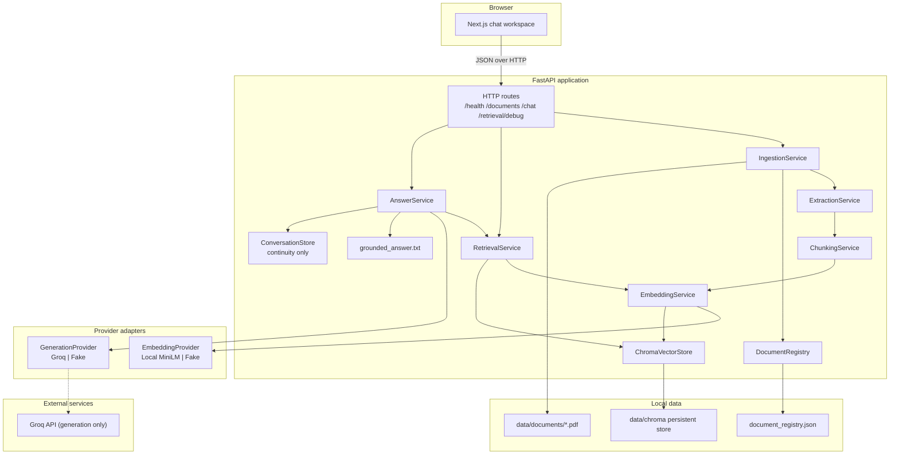
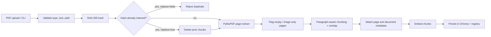
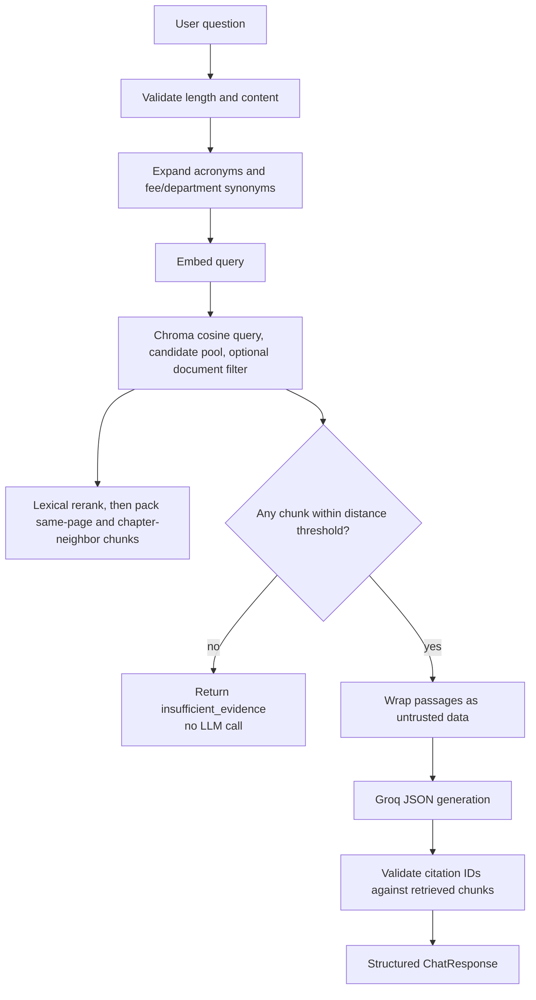
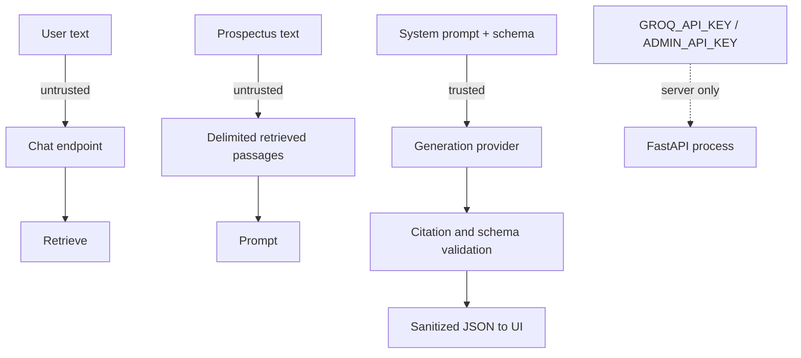

# Architecture — NED Prospectus Assistant

## System context

The assistant is a retrieval-augmented generation (RAG) system. User questions are answered only from chunks that were extracted from ingested prospectus PDFs. The language model is a constrained formatter of retrieved evidence, not a source of university policy.

## Ingestion pipeline

## Query pipeline

## Trust boundaries

## Component responsibilities

| Component | Responsibility | Must not do |
| --- | --- | --- |
| `ExtractionService` | Page text, page numbers, OCR flags | Interpret content |
| `ChunkingService` | Size/overlap, paragraph boundaries | Call an LLM |
| `EmbeddingService` | Batch embed via provider | Store or retrieve |
| `ChromaVectorStore` | Persist and query vectors | Generate answers |
| `RetrievalService` | Top-k, threshold, filters, debug payload | Call the generator |
| `AnswerService` | Prompt assembly, JSON parse, citation check, refusal | Use chat history as evidence |
| `DocumentRegistry` | Hash, metadata, duplicate policy | Embed text |
| Frontend | Display answers and sources | Invent answers or hold API keys |

## Runtime configuration (summary)

See `.env.example` for the full list. The important RAG knobs:

- `CHUNK_SIZE_CHARS` / `CHUNK_OVERLAP_CHARS`
- `RETRIEVAL_TOP_K`
- `RETRIEVAL_MAX_DISTANCE` (cosine distance; lower is closer)
- `EMBEDDING_PROVIDER` / `GENERATION_PROVIDER`
- `EMBEDDING_MODEL` / `GROQ_MODEL`
